<div align="center">


**Serverless flood-rescue triage for Bihar, built on AWS.**
Hindi, Hinglish and dialect voice or text reports become one ranked, de-duplicated rescue queue on a live 3D map, plus early river warnings in Hindi voice.

[](https://github.com/antrikakashyap/baadhmitra/actions/workflows/ci.yml)


### [Open the 3D demo](https://dr2l39p60xv7s.cloudfront.net/index.html?demo=1) · [Citizen report page](https://dr2l39p60xv7s.cloudfront.net/report.html) · [Staff dashboard (login)](https://dr2l39p60xv7s.cloudfront.net/)

<sub>Live links point to the author's personal AWS test deployment and may be offline. The demo runs entirely in your browser with invented messages; no real people or data.</sub>

</div>

> **Status:** working prototype, deployed by its author to a personal AWS account for testing. It has **not** been used in a real flood, no agency has endorsed it, and extraction accuracy on real messages is unmeasured. River levels are simulated (and labelled `sim`) until an official feed is connected. The path to a real pilot is in [`docs/PILOT.md`](docs/PILOT.md).

---

## See it

<p align="center">
  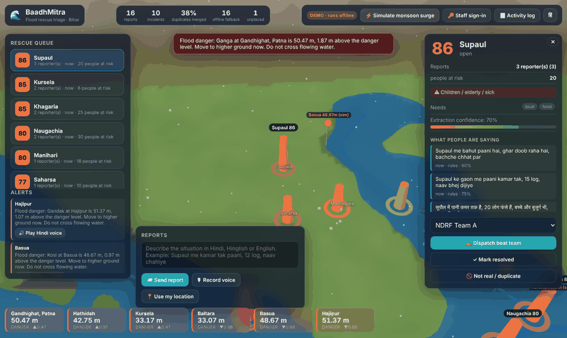
  <br/><sub><b>Monsoon surge:</b> gauges climb, the flood plane rises, Hindi alerts fire, and the queue re-ranks itself.</sub>
</p>

<table>
  <tr>
    <td width="50%">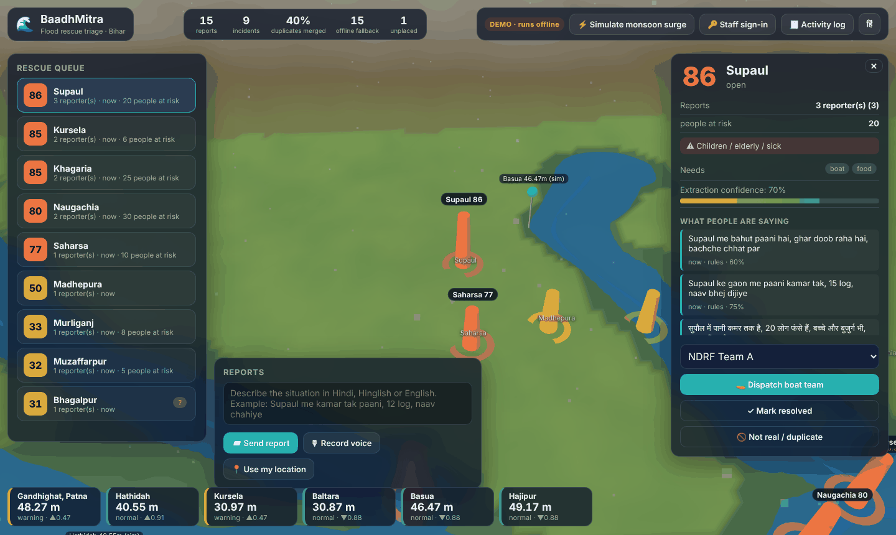<br/><sub><b>Rescue queue + 3D map.</b> Twenty reports from one village are one incident, scored 0 to 100 with the evidence beside it.</sub></td>
    <td width="50%">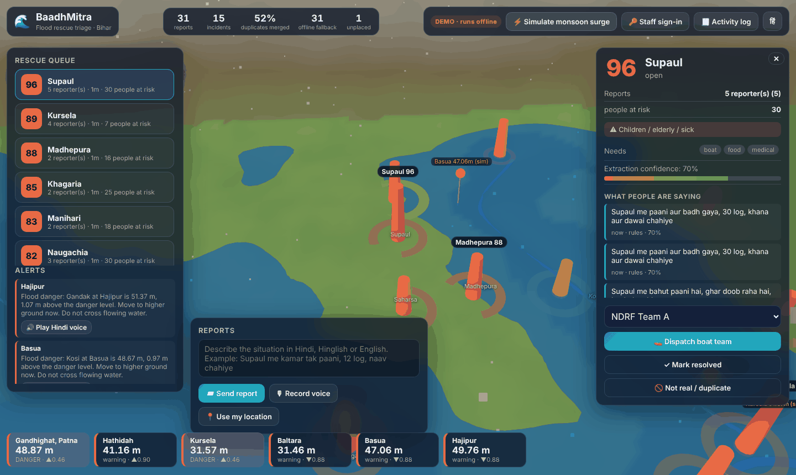<br/><sub><b>Early warning.</b> Gauges in danger, Hindi voice alerts, and grey "stale" cards when a source stops updating.</sub></td>
  </tr>
  <tr>
    <td width="50%">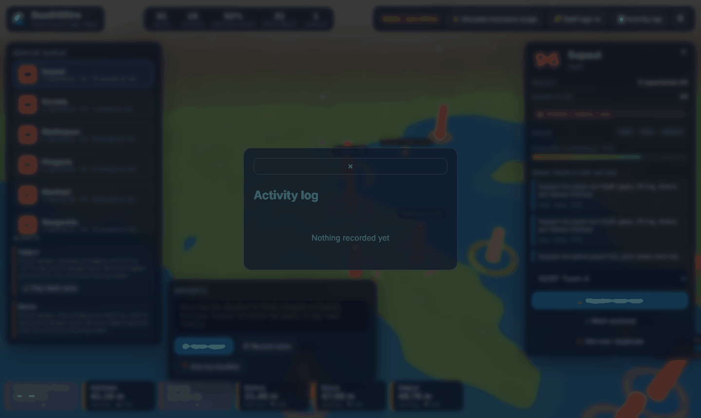<br/><sub><b>Accountability.</b> Every assign, resolve, dismiss and replay is logged: who, what, when.</sub></td>
    <td width="50%">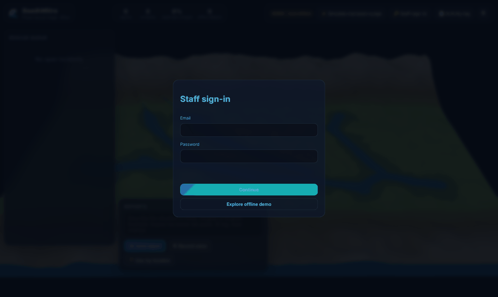<br/><sub><b>Role-based login.</b> Cognito, no self sign-up. Viewer, control room and district officer see different actions.</sub></td>
  </tr>
</table>

<table>
  <tr>
    <td width="50%">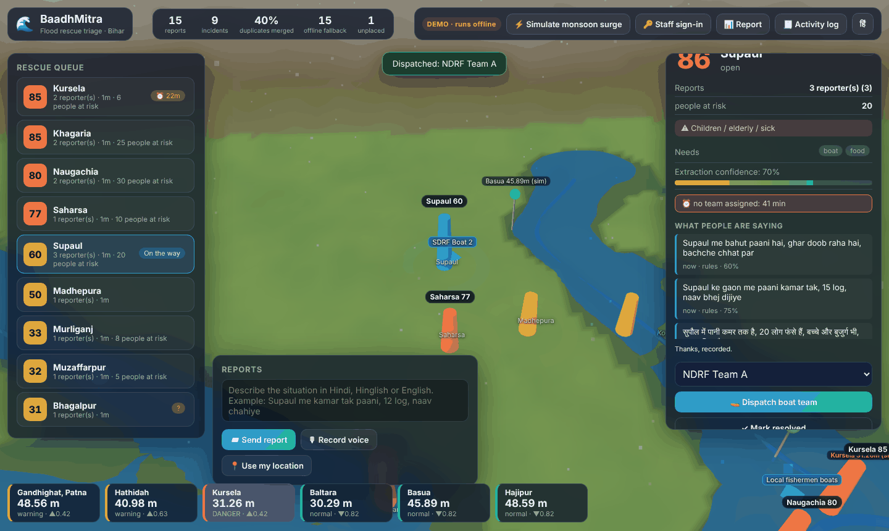<br/><sub><b>Overdue clock + live crews.</b> Amber and red badges for waiting incidents; blue markers for crews that share their location.</sub></td>
    <td width="50%">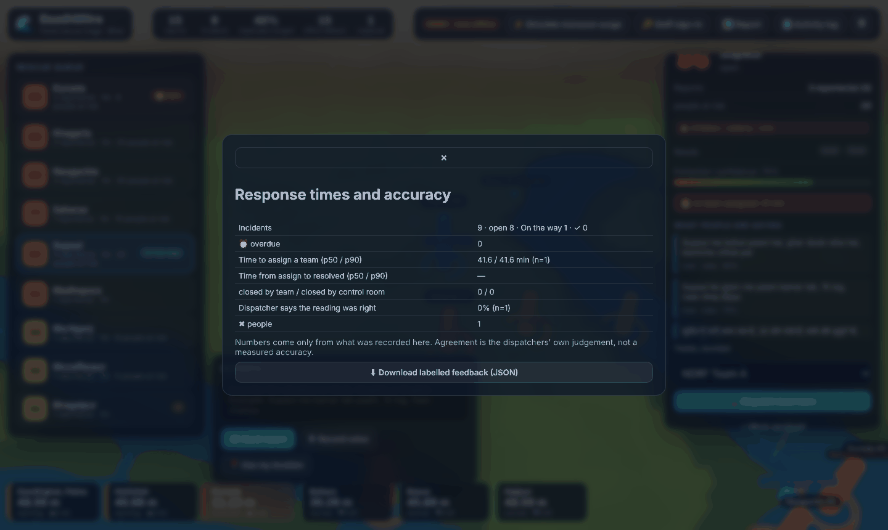<br/><sub><b>Response-time report.</b> Time to assign and resolve, who closed it, and how often dispatchers agreed with the system.</sub></td>
  </tr>
</table>

<table>
  <tr>
    <td width="260" align="center">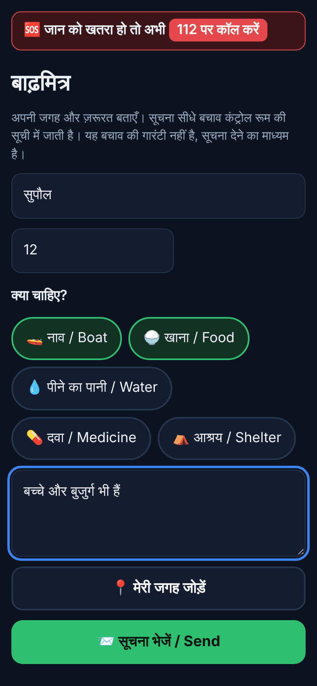</td>
    <td valign="top">

### The citizen page works with no signal
Hindi first, big buttons, installable as a PWA. A report typed offline is saved on the phone and sent when the network returns. It never asks for a phone number, shows **112** at the top, and says plainly that a report is not a rescue guarantee.

Try it: [`/report.html`](https://dr2l39p60xv7s.cloudfront.net/report.html)

</td>
  </tr>
  <tr>
    <td width="260" align="center">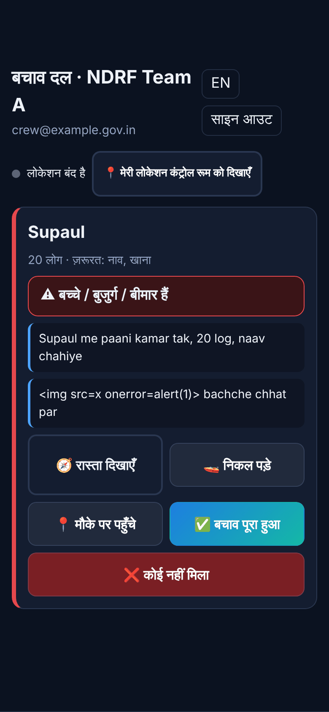</td>
    <td valign="top">

### The rescue crew's page
`/field.html`, sign-in required (role `field_team`). Shows only the incidents assigned to that crew, with a navigation link and big one-tap buttons. Taps are queued on the phone and sent when the signal returns. "Done" and "nobody found" need a second tap to confirm, and "nobody found" sends the incident back to the queue flagged for a human.

</td>
  </tr>
</table>

---

## What it does

| | |
| --- | --- |
| 🗣️ **Understands people** | Amazon Transcribe for voice, Amazon Bedrock (Claude) to extract place, depth, people at risk, needs and vulnerable people. A rule-based Hindi/Hinglish extractor (with a best-effort Bhojpuri/Maithili word list) takes over if the model is down. |
| 🧩 **Merges and ranks** | Reports from the same area merge into one incident. Priority weighs severity, **independent** reporters, people at risk, children/elderly/medical need. One phone repeating itself counts once. |
| 🗺️ **Shows it in 3D** | Three.js Bihar terrain, rivers, a flood plane that rises with the gauges, rain, incident beacons and boats that sail to assigned incidents. |
| 📲 **Takes reports anywhere** | Offline-first phone page, voice notes, location pin, and a signed WhatsApp webhook (Meta approval needed). |
| 🚤 **Closes the loop with rescue crews** | Crews get their own phone page: assigned incident, navigation link, one-tap progress (on the way / arrived / done / nobody found) that survives bad signal, and optional live location shown on the 3D map. A crew's "done" is what resolves an incident. |
| ⏰ **Never lets a request sit** | Overdue clock on every incident (no team assigned, or a team gone silent). Badges on the queue, and an alert to the ops topic once per level. |
| 📊 **Measures itself** | Dispatchers mark whether the system read an incident correctly. A report shows time to assign, time to resolve, who closed what, and the dispatchers' agreement rate, so accuracy comes from real use instead of guesses. |
| 🔐 **Protects the control room** | Cognito roles, server-side checks, append-only audit log, per-sender rate limit, API throttles, optional WAF. |
| 🌊 **Warns early, honestly** | Gauge poller with Hindi voice from Amazon Polly. With a real feed configured, simulation is never used; stale readings are greyed out and never alert. |

---

## The problem

Every monsoon the Kosi, Gandak and Ganga basins flood. Control rooms get a flood of calls and WhatsApp voice notes ("paani ghar mein ghus gaya, bachche chhat pe hain") that are unstructured, duplicated, and often have no coordinates. Boats go to whoever shouts loudest, not to whoever is in the most danger.

## Architecture

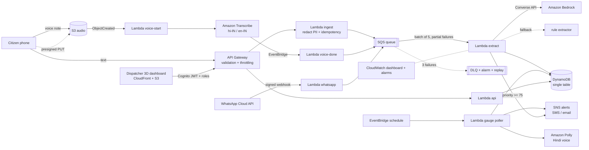

## Design decisions worth knowing

| Concern | Decision |
| --- | --- |
| Duplicate reports | Idempotency key per (sender, text, 10 min). One phone texting ten times counts once in the incident's reporter count, so a panicked family cannot inflate its own priority, and spam is cheap to ignore. |
| Lost updates | Incident writes use optimistic locking (`ver` + conditional put) with a retry loop. Two reports for the same village arriving together both land. |
| Poison messages | SQS partial batch response, 3 receives, then a dead-letter queue with a CloudWatch alarm and a `POST /admin/replay` redrive endpoint. |
| Bedrock outage or throttling | 9 s timeout, then the offline rule extractor. The fallback rate is a metric on the dashboard. |
| Prompt injection | Reports are untrusted. The model only produces data that is validated field by field (enums, ranges, known needs). Nothing the model says triggers an action. |
| Privacy | Phone numbers, Aadhaar-style numbers, UPI ids and emails are redacted before storage and before any text reaches the model. Sender ids are salted hashes. Audio expires after 30 days, reports after 7. |
| Never drop a cry for help | A report that cannot be placed on the map goes to an `unplaced` list for a human instead of being discarded. Low-confidence incidents are flagged for review until several independent people corroborate them. |
| Human in the loop | The system ranks and recommends. A dispatcher assigns teams. A person can dismiss a false or duplicate incident; a new independent report re-opens it. |
| Real vs simulated data | With a real gauge feed configured the simulator is never used. Old readings are greyed out, raise no alerts, and trigger an alarm. |
| Access | Cognito with no self sign-up and role groups, enforced by the API on every call, plus an append-only audit log. |
| Cost control | On-demand DynamoDB, ARM Lambdas, extractor concurrency capped at 5, per-route API throttles. |
| Offline resilience | The gazetteer works with no network call, and the dashboard runs end to end in a demo mode with the same shared code as the Lambdas. |

## Docs for a real pilot

| Doc | For |
| --- | --- |
| [`PILOT.md`](docs/PILOT.md) | one-district shadow pilot: scope, what the department provides, what to measure, risks |
| [`DEPLOY-INDIA.md`](docs/DEPLOY-INDIA.md) | region, staff accounts (Windows CMD commands), real gauge feed, village data, go-live checklist |
| [`SOP.md`](docs/SOP.md) | control-room runbook: working the queue, what to do when something breaks |
| [`SECURITY.md`](docs/SECURITY.md) · [`PRIVACY.md`](docs/PRIVACY.md) | what is protected, known gaps, data handling notes for legal review |
| [`WHATSAPP.md`](docs/WHATSAPP.md) | connecting the Meta WhatsApp Business webhook |
| [`PITCH.md`](docs/PITCH.md) · [`DEMO-SCRIPT.md`](docs/DEMO-SCRIPT.md) | one-page pitch and a 5-minute demo script |

## Repo layout

```
shared/     code used by Lambdas, the dashboard and tests (geohash, gazetteer, redaction,
            extractor, scoring, alert wording, gauge simulator)
backend/    Lambda handlers: ingest, voice, extract, api, gauge, whatsapp (+ lib: intake, auth, feed, wa)
infra/      AWS CDK stack (TypeScript)
web/        3D dispatcher dashboard (Three.js + Vite), offline citizen report page, rescue-crew page
docs/       pilot plan, deploy checklist, runbook, security, privacy, WhatsApp, pitch, demo script
scripts/    deploy, village importer, load test
eval/       labeled messages + benchmark script
test/       unit tests and CDK assertion tests
```

## Run the dashboard locally (no AWS needed)

```bash
npm ci
npm run web          # opens the 3D dashboard in demo mode
```

Click an incident, dispatch a team, type a report, or press **Simulate monsoon surge** to watch the water rise and Hindi alerts fire.

## Deploy to AWS

Prerequisites: AWS credentials for the target account (`aws configure` or `aws sso login`), AWS CLI v2, Node 22, and in your chosen region (default `ap-south-1`, Mumbai; your organisation may restrict regions, the prototype ran in `ap-southeast-2`: `aws configure set region <region>`): Amazon Bedrock model access, Amazon Transcribe, and Amazon Polly (Kajal, neural, hi-IN).

```bash
AWS_REGION=ap-south-1 MODEL_ID=<a Bedrock model or inference-profile id you can use> ./scripts/deploy.sh
```

The script runs the tests, builds the 3D dashboard, bootstraps CDK, deploys the whole stack (API, Lambdas, SQS + DLQ, DynamoDB, S3, EventBridge, SNS, CloudWatch, CloudFront site) and prints the dashboard URL and the citizen page URL. Create the first staff account with `ADMIN_EMAIL=you@example.com ./scripts/deploy.sh`, or with the two CLI commands in `docs/DEPLOY-INDIA.md`, then sign in.

Alternatives: run the same script from AWS CloudShell, or use **Actions > deploy** in GitHub (set the repository variable `AWS_ROLE_ARN` to an IAM role that trusts GitHub OIDC for this repo).

Manual steps, if you prefer: `npm ci && npm run web:build && npx cdk bootstrap && npx cdk deploy -c modelId=<id>`, then create a Cognito user and add it to a group (`docs/DEPLOY-INDIA.md`).

Optional settings: `-c gaugeFeedUrl=https://...` (feed shaped `[{id,name,river,lat,lon,lvl,danger,ts?}]`), `-c reportRps=50`, `-c waf=true`. Without a feed, readings are simulated and flagged.

If Bedrock access or the model id is wrong, the system keeps working on the rule extractor and the dashboard shows the fallback count rising. To remove everything: `npx cdk destroy` (the DynamoDB table is retained by design).

## API

| Route | Auth | Purpose |
| --- | --- | --- |
| `POST /reports` | public, throttled, per-sender limit | `{text, sender?, lat?, lon?}` |
| `POST /upload-url` | public, throttled | presigned URL for a voice note |
| `POST /subscribe` | public, throttled | email for alerts |
| `GET/POST /whatsapp` | public, HMAC signature checked | Meta webhook |
| `GET /incidents`, `/gauges`, `/alerts`, `/stats`, `/unplaced` | Cognito, any role | dispatcher data |
| `POST /incidents/{id}/assign`, `/resolve`, `/dismiss`, `/feedback` | Cognito, `control_room` or `district_officer` | dispatch actions and the accuracy verdict (audited) |
| `GET /teams`, `GET /metrics` | Cognito, any staff role | crew positions, response-time report |
| `POST /field/ping`, `GET /field/mine`, `POST /field/{id}/progress` | Cognito, `field_team` only | the crew's own phone |
| `POST /admin/replay`, `GET /audit`, `GET /feedback` | Cognito, `district_officer` | redrive the dead-letter queue, activity log, labelled-feedback export |

## Testing and evaluation

```bash
npm run typecheck && npm test      # 66 tests: core logic, the Lambda pipeline against a fake AWS, roles and audit, WhatsApp signatures, feeds, offline queue, CDK guarantees
npm run eval                       # extractor benchmark (add LLM=1 MODEL=<id> to score Bedrock)
npx cdk synth                      # validates the CloudFormation template
npm run loadtest -- <api> 200 20 --yes   # load test the public endpoint (use a staging stack)
```

An honest note on the benchmark: `eval/labeled.json` is a starter set written by the project author alongside the rule extractor, so its near-perfect score is a regression guard, not an accuracy claim. Writing the set already exposed a real bug (the Hindi phrase "aa gaya" was being read as the city Gaya), now fixed and tested. To quote accuracy, label fresh messages you did not use while building and report per-field scores on those.

## Known limits and next steps

- Transcribe has no Maithili or Bhojpuri model, so Hindi is used; confidence drops on heavy dialect and the review queue catches it. The Bhojpuri/Maithili word list is best effort and needs native-speaker review.
- WhatsApp needs a Meta business account and approval; the webhook is built and tested but has not talked to the real Meta service.
- River data is simulated until you configure an official feed (and get permission for it). Village-level placement needs a licensed village dataset (`npm run villages`); the shipped index is empty.
- MFA enrolment is not in the dashboard yet; CORS is open for demo convenience; no independent penetration test. See `docs/SECURITY.md` for the full list.
- SMS delivery in India requires DLT registration with SNS; email alerts work immediately.
- The benchmark set is author-written; real accuracy is measured in a pilot (`docs/PILOT.md`).
- Crew location is only as good as the phone and the crew's choice to share it. The overdue thresholds (15/30 and 30/60 minutes, 60/120 for a silent crew) are starting values to agree with the control room, not standards.
- Next: resource-aware team suggestions, IVR / missed-call intake, district-boundary heatmap, a list screen for unplaced reports.
