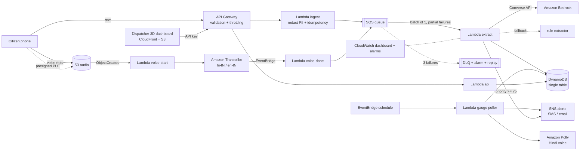

# BaadhMitra · बाढ़मित्र

**Serverless flood-rescue triage for Bihar.** People in flooded villages send distress messages as Hindi, Hinglish or Maithili-flavoured text and voice notes. BaadhMitra turns that noise into one ranked rescue queue on a 3D map, and warns villages by SMS and Hindi voice when a river nears its danger mark. Built on AWS.

> Status: working prototype. The pipeline, infrastructure and dashboard are built and tested. It has not been deployed to a live flood and nothing here is endorsed by any agency. River levels run on a **simulator** until you plug in an official feed, and are always labelled `sim`.

## The problem

Every monsoon the Kosi, Gandak and Ganga basins flood. Control rooms get a flood of calls and WhatsApp voice notes ("paani ghar mein ghus gaya, bachche chhat pe hain") that are unstructured, duplicated, and often have no coordinates. Boats go to whoever shouts loudest, not to whoever is in the most danger.

## What it does

1. **Takes reports** by text or voice note (mobile web, or any client that can call the API).
2. **Understands them**: Amazon Transcribe for voice, Amazon Bedrock (Claude) to extract place, water depth, people at risk, needs and vulnerable people. A rule-based Hindi/Hinglish extractor takes over if the model is down, so the system degrades instead of failing.
3. **Clusters and ranks**: twenty reports from one village become one incident. A priority score weighs severity, independent reporters, people at risk, vulnerable people and medical need.
4. **Shows it in 3D**: a Bihar terrain with the rivers, a flood plane that rises with the gauges, rain, incident beacons, and boats that sail to assigned incidents.
5. **Warns early**: a scheduled poller watches river gauges and, on escalation, sends an SMS/email alert plus a Hindi voice message synthesized with Amazon Polly.

## Architecture



## Design decisions worth knowing

| Concern | Decision |
| --- | --- |
| Duplicate reports | Idempotency key per (sender, text, 10 min). One phone texting ten times counts once in the incident's reporter count, so a panicked family cannot inflate its own priority, and spam is cheap to ignore. |
| Lost updates | Incident writes use optimistic locking (`ver` + conditional put) with a retry loop. Two reports for the same village arriving together both land. |
| Poison messages | SQS partial batch response, 3 receives, then a dead-letter queue with a CloudWatch alarm and a `POST /admin/replay` redrive endpoint. |
| Bedrock outage or throttling | 9 s timeout, then the offline rule extractor. The fallback rate is a metric on the dashboard. |
| Prompt injection | Reports are untrusted. The model only produces data that is validated field by field (enums, ranges, known needs). Nothing the model says triggers an action. |
| Privacy | Phone numbers, Aadhaar-style numbers, UPI ids and emails are redacted before storage and before any text reaches the model. Sender ids are salted hashes. Audio expires after 30 days, reports after 7. |
| Never drop a cry for help | A report that cannot be placed on the map goes to an `unplaced` list for a human instead of being discarded. Low-confidence incidents are flagged for review until several independent people corroborate them. |
| Human in the loop | The system ranks and recommends. A dispatcher assigns teams. |
| Cost control | On-demand DynamoDB, ARM Lambdas, extractor concurrency capped at 5, per-route API throttles. |
| Offline resilience | The gazetteer works with no network call, and the dashboard runs end to end in a demo mode with the same shared code as the Lambdas. |

## Repo layout

```
shared/     code used by Lambdas, the dashboard and tests (geohash, gazetteer, redaction,
            extractor, scoring, alert wording, gauge simulator)
backend/    Lambda handlers: ingest, voice, extract, api, gauge
infra/      AWS CDK stack (TypeScript)
web/        3D dispatcher dashboard (Three.js + Vite)
eval/       labeled messages + benchmark script
test/       unit tests and CDK assertion tests
```

## Run the dashboard locally (no AWS needed)

```bash
npm ci
npm run web          # opens the 3D dashboard in demo mode
```

Click an incident, dispatch a team, type a report, or press **Simulate monsoon surge** to watch the water rise and Hindi alerts fire.

## Deploy to AWS

Prerequisites: AWS credentials, Node 22, and these enabled in your chosen region (default `ap-south-1`, Mumbai): Amazon Bedrock model access, Amazon Transcribe, Amazon Polly (Kajal, neural, hi-IN).

```bash
npm ci
npm run web:build
npx cdk bootstrap
npx cdk deploy -c modelId=<a Bedrock model or inference-profile id you have access to>
aws apigateway get-api-key --api-key <ApiKeyId from the outputs> --include-value
```

Open `SiteUrl`, press **Connect to AWS**, paste the key. Subscribe an email to the alert topic with `POST /subscribe`.

Optional: `-c gaugeFeedUrl=https://...` points the poller at a JSON feed shaped `[{id,name,river,lat,lon,lvl,danger}]`. Without it, readings are simulated and flagged.

If Bedrock access or the model id is wrong, the system keeps working on the rule extractor and the dashboard shows the fallback count rising.

## API

| Route | Auth | Purpose |
| --- | --- | --- |
| `POST /reports` | public, throttled | `{text, sender?, lat?, lon?}` |
| `POST /upload-url` | public, throttled | presigned URL for a voice note |
| `POST /subscribe` | public | email or `+91` phone for alerts |
| `GET /incidents`, `/gauges`, `/alerts`, `/stats`, `/unplaced` | API key | dispatcher data |
| `POST /incidents/{id}/assign`, `/resolve` | API key | dispatch actions |
| `POST /admin/replay` | API key | redrive the dead-letter queue |

## Testing and evaluation

```bash
npm run typecheck && npm test      # 29 tests: core logic and CDK infrastructure guarantees
npm run eval                       # extractor benchmark (add LLM=1 MODEL=<id> to score Bedrock)
npx cdk synth                      # validates the CloudFormation template
```

An honest note on the benchmark: `eval/labeled.json` is a starter set written by the project author alongside the rule extractor, so its near-perfect score is a regression guard, not an accuracy claim. Writing the set already exposed a real bug (the Hindi phrase "aa gaya" was being read as the city Gaya), now fixed and tested. To quote accuracy, label fresh messages you did not use while building and report per-field scores on those.

## Known limits and next steps

- Transcribe has no Maithili or Bhojpuri model, so Hindi is used; confidence drops on heavy dialect and the review queue catches it.
- SMS delivery in India requires DLT registration with SNS; email alerts work immediately.
- Dispatcher access uses one API key. Production should use Cognito with per-team roles and audit logs.
- The gazetteer covers district HQs and well-known flood towns. Village-level lookup would use Amazon Location Service.
- River geometry and gauge danger levels in the demo are illustrative. Use official data in any real deployment.
- Next: WhatsApp Business webhook intake, a district-boundary heatmap, offline-first PWA for field teams.
