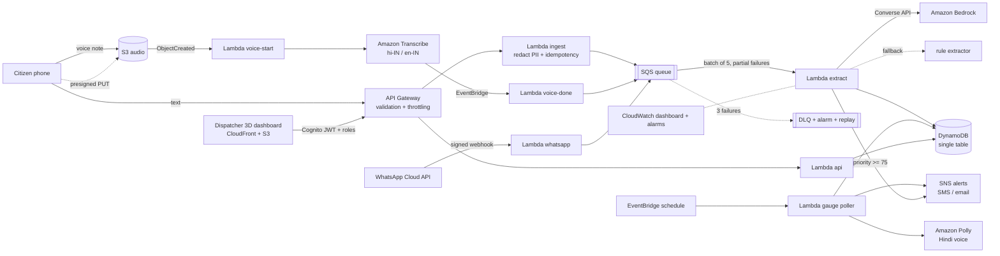

# BaadhMitra · बाढ़मित्र

**Serverless flood-rescue triage for Bihar.** People in flooded villages send distress messages as Hindi, Hinglish or Maithili-flavoured text and voice notes. BaadhMitra turns that noise into one ranked rescue queue on a 3D map, and warns villages by SMS and Hindi voice when a river nears its danger mark. Built on AWS.

> Status: working prototype, deployed by its author to a personal AWS account for testing. The pipeline, infrastructure and dashboard are built and tested. It has not been used in a real flood, nothing here is endorsed by any agency, and extraction accuracy on real messages is unmeasured. To take it toward a government pilot, see `docs/PILOT.md` and `docs/DEPLOY-INDIA.md`. River levels run on a **simulator** until you plug in an official feed, and are always labelled `sim`.

## The problem

Every monsoon the Kosi, Gandak and Ganga basins flood. Control rooms get a flood of calls and WhatsApp voice notes ("paani ghar mein ghus gaya, bachche chhat pe hain") that are unstructured, duplicated, and often have no coordinates. Boats go to whoever shouts loudest, not to whoever is in the most danger.

## What it does

1. **Takes reports** by text, voice note or location pin: a Hindi-first phone page that queues reports offline (`/report.html`, installable as a PWA), or WhatsApp (needs Meta business approval, see `docs/WHATSAPP.md`).
2. **Understands them**: Amazon Transcribe for voice, Amazon Bedrock (Claude) to extract place, water depth, people at risk, needs and vulnerable people. A rule-based Hindi/Hinglish extractor takes over if the model is down, so the system degrades instead of failing.
3. **Clusters and ranks**: twenty reports from one village become one incident. A priority score weighs severity, independent reporters, people at risk, vulnerable people and medical need.
4. **Shows it in 3D**: a Bihar terrain with the rivers, a flood plane that rises with the gauges, rain, incident beacons, and boats that sail to assigned incidents.
5. **Protects the control room**: staff sign in with Cognito (roles: viewer, control_room, district_officer), every assign/resolve/dismiss is written to an audit log, and a per-sender rate limit plus optional WAF absorb spam.
6. **Warns early**: a scheduled poller watches river gauges and, on escalation, sends an SMS/email alert plus a Hindi voice message synthesized with Amazon Polly.

## Architecture



## Design decisions worth knowing

| Concern | Decision |
| --- | --- |
| Duplicate reports | Idempotency key per (sender, text, 10 min). One phone texting ten times counts once in the incident's reporter count, so a panicked family cannot inflate its own priority, and spam is cheap to ignore. |
| Lost updates | Incident writes use optimistic locking (`ver` + conditional put) with a retry loop. Two reports for the same village arriving together both land. |
| Poison messages | SQS partial batch response, 3 receives, then a dead-letter queue with a CloudWatch alarm and a `POST /admin/replay` redrive endpoint. |
| Bedrock outage or throttling | 9 s timeout, then the offline rule extractor. The fallback rate is a metric on the dashboard. |
| Prompt injection | Reports are untrusted. The model only produces data that is validated field by field (enums, ranges, known needs). Nothing the model says triggers an action. |
| Privacy | Phone numbers, Aadhaar-style numbers, UPI ids and emails are redacted before storage and before any text reaches the model. Sender ids are salted hashes. Audio expires after 30 days, reports after 7. |
| Never drop a cry for help | A report that cannot be placed on the map goes to an `unplaced` list for a human instead of being discarded. Low-confidence incidents are flagged for review until several independent people corroborate them. |
| Human in the loop | The system ranks and recommends. A dispatcher assigns teams. A person can dismiss a false or duplicate incident; a new independent report re-opens it. |
| Real vs simulated data | With a real gauge feed configured the simulator is never used. Old readings are greyed out, raise no alerts, and trigger an alarm. |
| Access | Cognito with no self sign-up and role groups, enforced by the API on every call, plus an append-only audit log. |
| Cost control | On-demand DynamoDB, ARM Lambdas, extractor concurrency capped at 5, per-route API throttles. |
| Offline resilience | The gazetteer works with no network call, and the dashboard runs end to end in a demo mode with the same shared code as the Lambdas. |

## Repo layout

```
shared/     code used by Lambdas, the dashboard and tests (geohash, gazetteer, redaction,
            extractor, scoring, alert wording, gauge simulator)
backend/    Lambda handlers: ingest, voice, extract, api, gauge, whatsapp (+ lib: intake, auth, feed, wa)
infra/      AWS CDK stack (TypeScript)
web/        3D dispatcher dashboard (Three.js + Vite) and the offline citizen report page
docs/       pilot plan, deploy checklist, runbook, security, privacy, WhatsApp, pitch, demo script
scripts/    deploy, village importer, load test
eval/       labeled messages + benchmark script
test/       unit tests and CDK assertion tests
```

## Run the dashboard locally (no AWS needed)

```bash
npm ci
npm run web          # opens the 3D dashboard in demo mode
```

Click an incident, dispatch a team, type a report, or press **Simulate monsoon surge** to watch the water rise and Hindi alerts fire.

## Deploy to AWS

Prerequisites: AWS credentials for the target account (`aws configure` or `aws sso login`), AWS CLI v2, Node 22, and in your chosen region (default `ap-south-1`, Mumbai; your organisation may restrict regions, the prototype ran in `ap-southeast-2`: `aws configure set region <region>`): Amazon Bedrock model access, Amazon Transcribe, and Amazon Polly (Kajal, neural, hi-IN).

```bash
AWS_REGION=ap-south-1 MODEL_ID=<a Bedrock model or inference-profile id you can use> ./scripts/deploy.sh
```

The script runs the tests, builds the 3D dashboard, bootstraps CDK, deploys the whole stack (API, Lambdas, SQS + DLQ, DynamoDB, S3, EventBridge, SNS, CloudWatch, CloudFront site) and prints the dashboard URL and the citizen page URL. Create the first staff account with `ADMIN_EMAIL=you@example.com ./scripts/deploy.sh`, or with the two CLI commands in `docs/DEPLOY-INDIA.md`, then sign in.

Alternatives: run the same script from AWS CloudShell, or use **Actions > deploy** in GitHub (set the repository variable `AWS_ROLE_ARN` to an IAM role that trusts GitHub OIDC for this repo).

Manual steps, if you prefer: `npm ci && npm run web:build && npx cdk bootstrap && npx cdk deploy -c modelId=<id>`, then create a Cognito user and add it to a group (`docs/DEPLOY-INDIA.md`).

Optional settings: `-c gaugeFeedUrl=https://...` (feed shaped `[{id,name,river,lat,lon,lvl,danger,ts?}]`), `-c reportRps=50`, `-c waf=true`. Without a feed, readings are simulated and flagged.

If Bedrock access or the model id is wrong, the system keeps working on the rule extractor and the dashboard shows the fallback count rising. To remove everything: `npx cdk destroy` (the DynamoDB table is retained by design).

## API

| Route | Auth | Purpose |
| --- | --- | --- |
| `POST /reports` | public, throttled, per-sender limit | `{text, sender?, lat?, lon?}` |
| `POST /upload-url` | public, throttled | presigned URL for a voice note |
| `POST /subscribe` | public, throttled | email for alerts |
| `GET/POST /whatsapp` | public, HMAC signature checked | Meta webhook |
| `GET /incidents`, `/gauges`, `/alerts`, `/stats`, `/unplaced` | Cognito, any role | dispatcher data |
| `POST /incidents/{id}/assign`, `/resolve`, `/dismiss` | Cognito, `control_room` or `district_officer` | dispatch actions (audited) |
| `POST /admin/replay`, `GET /audit` | Cognito, `district_officer` | redrive the dead-letter queue, read the activity log |

## Testing and evaluation

```bash
npm run typecheck && npm test      # 56 tests: core logic, the Lambda pipeline against a fake AWS, roles and audit, WhatsApp signatures, feeds, offline queue, CDK guarantees
npm run eval                       # extractor benchmark (add LLM=1 MODEL=<id> to score Bedrock)
npx cdk synth                      # validates the CloudFormation template
npm run loadtest -- <api> 200 20 --yes   # load test the public endpoint (use a staging stack)
```

An honest note on the benchmark: `eval/labeled.json` is a starter set written by the project author alongside the rule extractor, so its near-perfect score is a regression guard, not an accuracy claim. Writing the set already exposed a real bug (the Hindi phrase "aa gaya" was being read as the city Gaya), now fixed and tested. To quote accuracy, label fresh messages you did not use while building and report per-field scores on those.

## Known limits and next steps

- Transcribe has no Maithili or Bhojpuri model, so Hindi is used; confidence drops on heavy dialect and the review queue catches it. The Bhojpuri/Maithili word list is best effort and needs native-speaker review.
- WhatsApp needs a Meta business account and approval; the webhook is built and tested but has not talked to the real Meta service.
- River data is simulated until you configure an official feed (and get permission for it). Village-level placement needs a licensed village dataset (`npm run villages`); the shipped index is empty.
- MFA enrolment is not in the dashboard yet; CORS is open for demo convenience; no independent penetration test. See `docs/SECURITY.md` for the full list.
- SMS delivery in India requires DLT registration with SNS; email alerts work immediately.
- The benchmark set is author-written; real accuracy is measured in a pilot (`docs/PILOT.md`).
- Next: district-boundary heatmap, a list screen for unplaced reports, field-team PWA.
